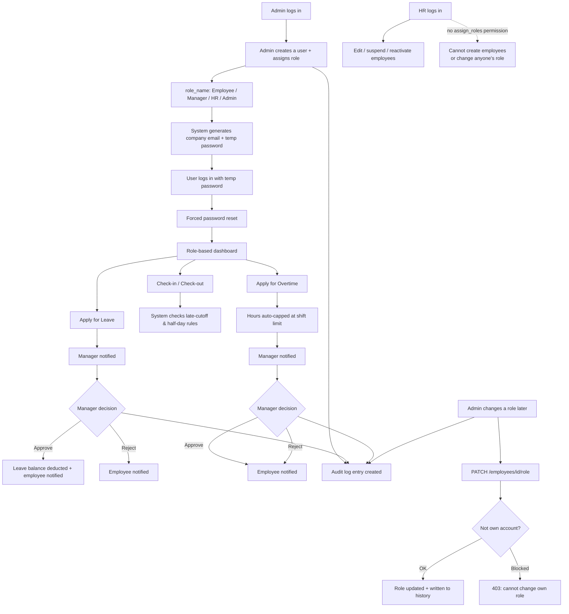

# Meridian Systems — Employee Management System

A full-stack Employee Management System: a **FastAPI + MySQL** backend exposing a REST API, and a **PyQt5** desktop client consuming it. Built around a real MVC split — the client is the View, the API is the Controller, MySQL is the Model.

## What it does

- **Employee lifecycle** — Admin/HR create employees (auto-generated company email + temporary password), edit their department/position/shift/manager, suspend/reactivate accounts, and view a full change history per employee.
- **Auth** — JWT login, forced password reset on first login, account lockout after repeated failed attempts, and a forgot-password flow using emailed (or console-logged, for local dev) one-time codes.
- **Attendance** — check-in/check-out with automatic late and half-day detection based on each employee's shift rules.
- **Leave** — apply for leave, manager approval/rejection (self-approval blocked), automatic balance deduction, and a per-employee leave balance view.
- **Overtime** — apply for overtime (auto-capped at the shift's daily limit), manager approval/rejection.
- **Holidays** — company holiday calendar, viewable by everyone, managed by Admin.
- **Notifications** — employees and managers are notified automatically when leave/overtime is applied for or decided on.
- **Audit log** — every create/update/delete/approve/reject/suspend/reactivate action is recorded and viewable by Admin/HR.
- **Role-based access** — Admin, HR, Manager, and Employee each see only what they're permitted to (enforced on both the API and the desktop client).

## Architecture

```
PyQt5 (client/)  ──HTTP/JSON + JWT──▶  FastAPI (backend/)  ──SQLAlchemy──▶  MySQL (database/)
     View                                 Controller                          Model
```

## Project structure

```
employee_management_system/
├── database/
│   ├── schema.sql            All 19 tables + seed data (roles, permissions,
│   │                         employment types, leave types, a sample shift)
│   ├── create_db.py          Creates the MySQL database from schema.sql
│   └── dev_tools/
│       └── check_db.py       Dumps table contents directly, for debugging
│
├── backend/                  FastAPI application
│   ├── app/
│   │   ├── core/              config.py, security.py, email.py
│   │   ├── models/            SQLAlchemy ORM models
│   │   ├── schemas/           Pydantic request/response validation
│   │   ├── controllers/       Business logic (the MVC "Controller")
│   │   ├── routers/           REST endpoint definitions
│   │   ├── database.py
│   │   ├── dependencies.py    Auth + permission checks
│   │   └── main.py            App entry point
│   ├── dev_tools/             unlock_user.py, set_manager.py — debugging only
│   ├── seed_admin.py          One-time bootstrap: creates the first Admin
│   ├── requirements.txt
│   └── .env.example
│
├── client/                   PyQt5 desktop application
│   ├── controllers/           One HTTP-calling module per backend router
│   │                          (auth, employee, org, leave, attendance,
│   │                          overtime, holiday, notification, audit)
│   ├── views/                 One screen/dialog per file; main_window.py
│   │                          shows only the tabs each role can use
│   ├── resources/styles/      Application stylesheet (style.qss)
│   ├── main.py                Entry point
│   └── requirements.txt
│
├── API_REFERENCE.md          Every endpoint, required role, and request/response body
├── TESTING.md                 Manual test scenarios and results
└── .gitignore
```

## Roles & permissions

| Feature | Admin | HR | Manager | Employee |
|---|:---:|:---:|:---:|:---:|
| Create employees & assign/change roles | ✅ | ❌ | ❌ | ❌ |
| Edit/suspend/reactivate employees | ✅ | ✅ | ❌ | ❌ |
| Manage departments/positions/shifts | ✅ | ❌ | ❌ | ❌ |
| Approve leave/overtime | ✅ | ✅ | ✅ (own team) | ❌ |
| View all attendance/overtime | ✅ | ✅ | ✅ | ❌ |
| View audit log | ✅ | ✅ | ❌ | ❌ |
| Self-service (check-in/out, apply leave/overtime, view own history) | ✅ | ✅ | ✅ | ✅ |

Full detail, including every endpoint's exact permission requirement, is in [`API_REFERENCE.md`](./API_REFERENCE.md).

## System Flow



## Getting started

### 1. Create the database

Requires MySQL 8.x running locally. First `cp backend/.env.example backend/.env` and set your MySQL user/password in `DB_USER` / `DB_PASSWORD`, then:

```bash
cd database
pip install pymysql sqlalchemy cryptography
python create_db.py        # or: mysql -u root -p < schema.sql
```

### 2. Set up the backend

```bash
cd backend
python -m venv venv
source venv/bin/activate        # Windows: venv\Scripts\activate
pip install -r requirements.txt
cp .env.example .env            # Windows: copy .env.example .env
```

`SMTP_*` settings in `.env` are optional — leave `SMTP_HOST` blank and forgot-password OTPs print to the console instead of emailing (fine for local dev).

### 3. Seed the first Admin account

```bash
python seed_admin.py
```

Creates `priya.nair@meridian.com` / `Admin@123` by default — the Admin then creates every other user from inside the app. Edit `seed_admin.py` first if you want different details.

### 4. Run the backend

```bash
uvicorn app.main:app --reload --port 8000
```

Visit `http://127.0.0.1:8000/docs` for interactive Swagger UI covering every endpoint.

### 5. Run the desktop client

In a second terminal:

```bash
cd client
python -m venv venv && source venv/bin/activate   # optional
pip install -r requirements.txt
python main.py
```

Log in with the seeded Admin. Full client details (screen-by-screen, plus two documented backend gaps the client works around) are in [`client/README.md`](./client/README.md).

## Coding standards

- PEP8 formatting, type hints on function signatures.
- Strict MVC split: models never contain business logic, controllers never touch HTTP directly, routers only wire HTTP to controllers.
- All request/response validation lives in `schemas/` (Pydantic) — nothing downstream re-checks types.
- No hardcoded secrets — everything reads from `.env` via `core/config.py`.
- One password-hashing module (`core/security.py`) — nothing else touches bcrypt directly.

## Tech stack

**Backend:** Python, FastAPI, SQLAlchemy, Pydantic, MySQL (PyMySQL), JWT (python-jose), bcrypt (passlib)
**Frontend:** Python, PyQt5, requests
**Tooling:** uvicorn, pytest-friendly structure (see `TESTING.md`)

## Roles: how HR and Manager accounts actually get created

Every employee used to be hardcoded to the `Employee` role with no way to make someone HR or a Manager short of editing the database directly. That's fixed, and it's deliberately **Admin-only, full stop** — creating an account means choosing its role, so both actions live behind a single new permission:

- **At creation time** — the employee creation form (both `POST /api/employees` and the PyQt5 "New Employee" dialog) takes a `role_name` (`Employee` / `Manager` / `HR` / `Admin`, defaults to `Employee`).
- **After the fact** — `PATCH /api/employees/{employee_id}/role` (and a "Change Role" button in the Employees tab) promotes or demotes an existing employee.
- **Who can do this:** only **Admin**, via a dedicated `assign_roles` permission (see `database/schema.sql`) that's separate from `manage_employees`. HR keeps `manage_employees` — editing, suspending, and reactivating employees — but does **not** have `assign_roles`, so HR cannot create employees or change anyone's role at all; both the API (`403`) and the PyQt5 client (button hidden entirely) enforce this.
- Nobody, including Admin, can change their own role, to avoid accidental self-lockout.
- Every role change is written to the employee's history and the audit log.

So the flow is: Admin logs in → creates every account directly, including the first HR/Manager accounts, with `role_name` set at creation time. HR can then manage those employees day-to-day (edit, suspend, reactivate, approve leave/overtime) but never creates new accounts or touches anyone's role.

## Known limitations

- No `GET /api/employment-types` endpoint — the client falls back to the fixed seed values from `schema.sql` (see `client/controllers/org_controller.py`).
- No endpoint to list leave requests (own or all) — the client's leave-approval screen is built on top of the notification system instead, since applying for leave already notifies the manager with the request's ID.
- No refresh tokens — the JWT expires after 60 minutes and requires re-login.
- No file uploads (e.g. medical certificates for leave).
- Functional testing only — no load/performance testing yet.

See `TESTING.md` for the full record of what's been tested and how.
